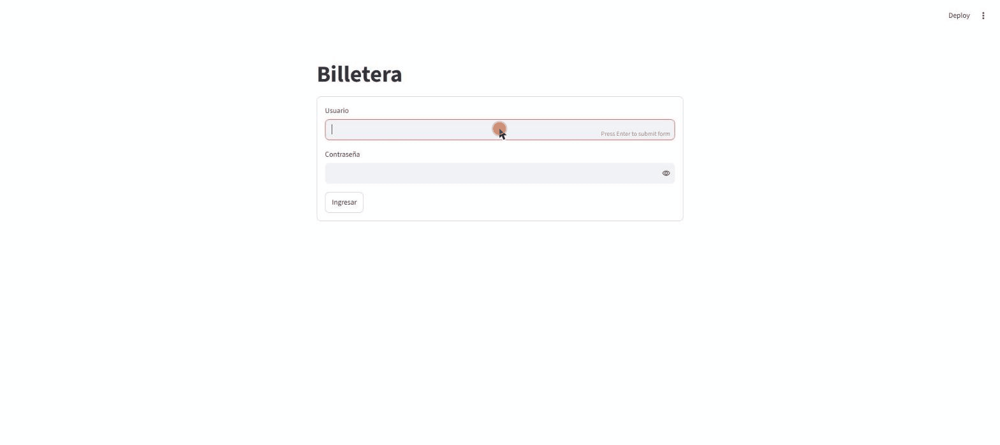
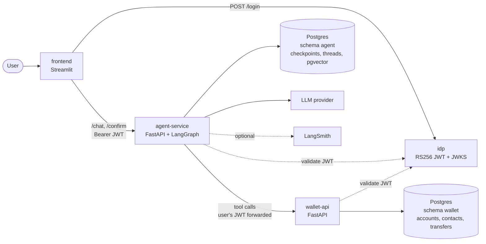
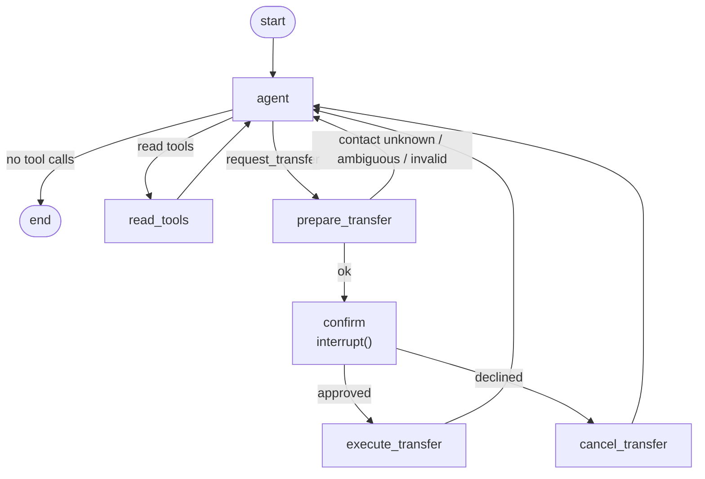

# wallet-agent

[](https://github.com/jcorta/wallet-agent/actions/workflows/ci.yml)

Reference implementation of a conversational assistant for a digital wallet, in which sensitive actions are gated by code and architecture rather than by prompts.

An authenticated user chats with an LLM agent that can read account data, request transfers and answer questions about fees and limits. The central property: **an agent cannot decide and execute on its own.**

- The agent never touches the wallet database. It calls an HTTP API that enforces the same controls as for any other client.
- The user's identity is never decided or seen by the model. It comes from a verified JWT that travels outside the model's context.
- Transfers require explicit human approval, enforced by the structure of the graph, not by an instruction to the model.



## Architecture



| Service | Responsibility |
|---|---|
| `idp` | Toy identity provider: `POST /login` issues a 15-minute RS256 access token; `GET /.well-known/jwks.json` publishes the key |
| `wallet-api` | Balance, transactions, contacts and transfers. Validates the JWT on its own and enforces every control |
| `agent-service` | LangGraph agent behind `POST /chat` and `POST /chat/{thread_id}/confirm` |
| `frontend` | Streamlit client: login, chat, confirm/cancel, logout |
| `postgres` | One database, one schema and one role per service (`wallet`, `agent`) |

There is no library shared between services. Where JWT validation, error bodies or logging setup are needed twice, they are written twice.

### The agent graph



`execute_transfer` is reachable only through `confirm`. The `request_transfer` tool the model sees does not move money; `prepare_transfer` resolves the contact and builds the summary, and the graph pauses at `confirm` until the client answers. State is checkpointed in Postgres, so a pending confirmation survives a restart of the service.

## Design decisions

**The agent does not touch the database.** Every action goes through wallet-api with the user's own token. Limits, balance checks, contact ownership and idempotency are applied exactly as for any other client, so there is no second, weaker code path to secure. The agent's database role cannot read the `wallet` schema either.

**RS256 with JWKS.** Services verify tokens with the idp's public key and never hold a signing secret. Issuer, audience and expiry are enforced; keys are cached and refetched on an unknown `kid`. Rotating keys needs no coordination with consumers.

**The token never reaches the model.** It travels in the LangGraph run config, not in messages or graph state, and tools read it from there. It is wrapped in a `SecretStr` because LangGraph copies plain strings from the run config into persisted checkpoint metadata and tracing metadata; a test asserts the token appears in no checkpoint. No tool exposes a user id parameter, so the model has nothing to forge. wallet-api derives the user only from `sub`.

**The interrupt lives in the graph, not the prompt.** A prompt injection can change what the model says or asks for, but it cannot add an edge to `execute_transfer`. The worst a manipulated model can do is ask the user to confirm something, and the summary shown at that point is built by code from the resolved contact and amount, not by the model. The system prompt also tells the model not to bypass confirmation, but nothing relies on that.

**Idempotency.** `POST /transfers` takes an `idempotency_key`, unique per user. A retry returns the stored outcome (completed or rejected) without debiting twice; the same key with a different payload is a `409`. The key is generated in `prepare_transfer`, before the interrupt, because LangGraph re-runs an interrupted node from its start on resume: a key created inside it would differ between pause and resume. Accounts are locked in id order before any check, so concurrent transfers cannot overdraw and opposite transfers cannot deadlock.

**Thread ownership.** Each thread records the user who created it. A foreign or unknown thread returns `404`, so a user can neither read nor confirm another user's pending transfer and cannot probe ids.

**Provider-agnostic models.** Chat models and embeddings are built from environment variables via `init_chat_model` / `init_embeddings`. No provider class is imported anywhere.

**Audit.** Every transfer attempt, including rejected ones with their reason, is stored in `transfers`.

### What would change in production

- A real identity provider with key rotation, and token exchange so the agent acts with a short-lived, reduced-scope token instead of the user's full access token.
- Step-up authentication for transfers above a threshold, enforced by wallet-api.
- A dedicated, append-only audit store; migrations (Alembic) instead of create-on-start; a secrets manager.
- Per-user rate limiting on the agent, and redaction of personal data before traces leave the environment.
- Output filtering and injection monitoring as defense in depth, never as the control itself.

## Running it

Requirements: Docker with Compose. Python 3.12 and [uv](https://docs.astral.sh/uv/) for running tests outside containers.

```bash
cp .env.example .env
# edit .env: set the passwords and GOOGLE_API_KEY (or the key for your provider)
docker compose up --build
```

| URL | Service |
|---|---|
| http://localhost:8501 | Chat UI |
| http://localhost:8001 | idp |
| http://localhost:8002 | wallet-api (`/docs` for the OpenAPI UI) |
| http://localhost:8003 | agent-service (`/docs`) |

Log in with one of the two sample users defined in `.env` (`USER1_*`, `USER2_*`). Sample data is loaded on first start. Ask for the balance, list contacts, or say "mandale 5000 a María": the assistant shows a summary and waits for **Confirmar** / **Cancelar**.

A terminal client is also available:

```bash
python agent-service/scripts/console.py --username <user> --password <password>
```

To start from a clean state: `docker compose down -v`.

### Changing the model

Set these in `.env` and restart `agent-service`; no code change is needed.

```bash
LLM_PROVIDER=anthropic
LLM_MODEL=<anthropic model id>
ANTHROPIC_API_KEY=...
```

Embeddings for the knowledge base are configured separately (`EMBEDDINGS_PROVIDER`, `EMBEDDINGS_MODEL`), since not every chat provider offers embeddings. Changing the embeddings model re-indexes the documents on the next start.

### Tracing

Set `LANGSMITH_TRACING=true`, `LANGSMITH_API_KEY` and optionally `LANGSMITH_PROJECT`. Without them the service runs unchanged. Traces include conversation content and tool results but not the user's token.

## Tests

Each service has lint and unit tests; CI runs them on every push.

```bash
cd <service>
uv sync
uv run ruff check . && uv run ruff format --check .
uv run pytest
```

`wallet-api` and part of `agent-service` need Postgres, because row locking, concurrency and checkpoint persistence are part of what is verified. Start the compose database and point the tests at it (compose publishes it on `127.0.0.1:5433`):

```bash
docker compose up -d postgres
export TEST_DATABASE_URL=postgresql+psycopg://postgres:<POSTGRES_PASSWORD>@127.0.0.1:5433/<POSTGRES_DB>
```

Tests create and drop their own schemas. Agent tests that need Postgres are skipped when `TEST_DATABASE_URL` is unset.

### Evals

`agent-service/evals/` holds behavioral cases that run against the live stack and the configured model: no transfer without confirmation, balance fidelity, no cross-user data, prompt injection, over-limit rejection, unknown and ambiguous contacts, thread ownership and knowledge-base answers. They assert on wallet-api state wherever possible rather than on wording. They need a running stack and model credentials, so they are not part of CI.

```bash
docker compose up -d
cd agent-service
uv run --env-file ../.env pytest evals -v
```

With `google_genai` / `gemini-3.1-flash-lite` all 17 cases pass.

Calls are spaced (`EVAL_DELAY_SECONDS`, default 3) and retried with backoff to cope with free-tier rate limits. To compare models, run the suite once per `LLM_PROVIDER` / `LLM_MODEL` setting and compare the reports (add `--junitxml=report.xml` to keep them). Use `-k` to run a subset.

## Known limitations

- The idp is a toy: two users from environment variables, an RSA key generated on first start and stored in a volume, no refresh tokens.
- The user's own access token is forwarded to wallet-api by the agent. A production design would exchange it for a narrower one.
- Contact resolution is name and alias matching, not fuzzy; "Juan" with two Juans always asks.
- A turn that mixes a transfer with other tool calls runs the transfer alone; the model has to repeat the others.
- If wallet-api is unreachable while a confirmed transfer executes, the request fails with `502` and the user has to retry; the idempotency key makes that retry safe once the service is reachable again.
- Tables are created on start; there are no migrations.
- Free-tier model quotas are small; the eval suite may need several runs or a paid key.

## Next steps

Token exchange for the agent, step-up authentication, Alembic migrations, per-user rate limiting, streaming responses, a richer frontend, deployment manifests.

## License

MIT
