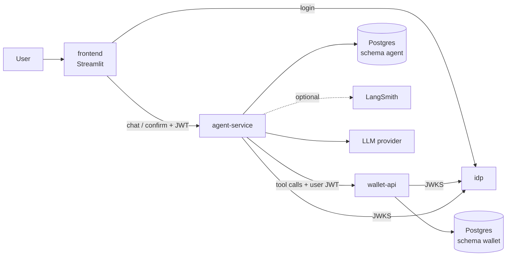
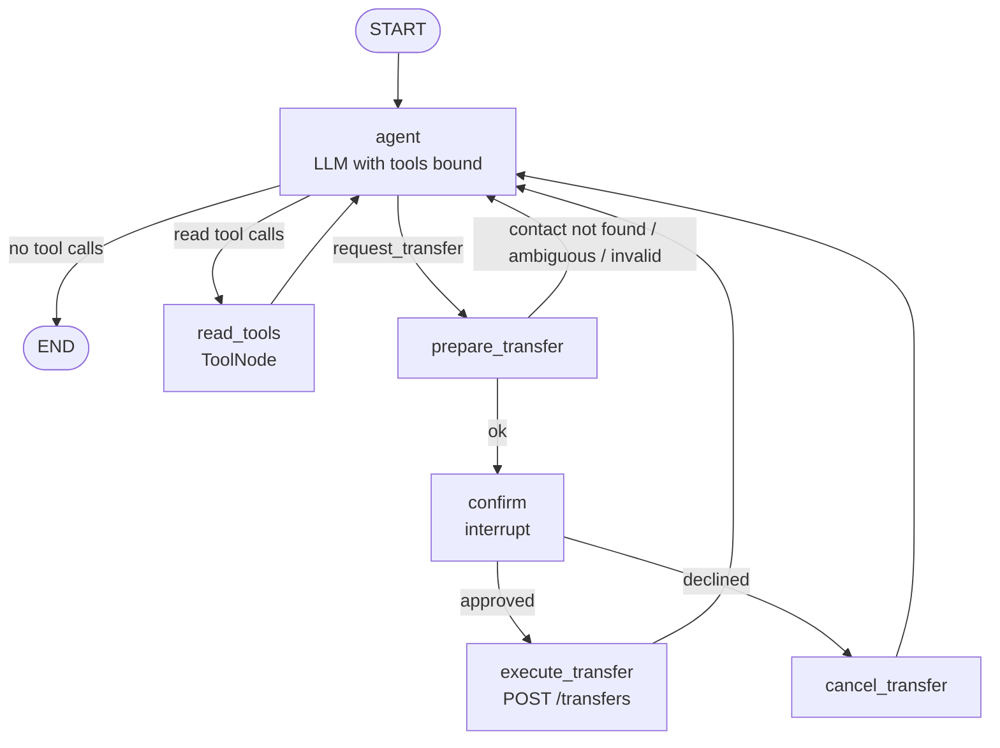

# wallet-agent — Implementation Plan

Companion to [spec.md](spec.md). Work is split into stages; each ends with a verified, working system and one conventional commit.

## 1. Service topology



Trust boundaries:

- The LLM sees only messages and tool results. It never sees the JWT or a user id.
- wallet-api trusts nothing but a validated token. It does not know an agent exists.
- agent-service never connects to the `wallet` schema.

## 2. Repository layout per service

```
<service>/
├── pyproject.toml      uv-managed, versions pinned, ruff config
├── uv.lock
├── Dockerfile
├── src/<package>/
│   ├── main.py         app factory, routers, error handlers
│   ├── settings.py     pydantic-settings
│   ├── logging.py      JSON logging + request id middleware
│   ├── errors.py       uniform error body
│   └── ...
└── tests/
```

JWT validation, error handling and logging are intentionally duplicated across services rather than shared.

## 3. Agent graph

### 3.1 State

```python
class AgentState(MessagesState):
    pending_transfer: PendingTransfer | None   # contact_id, contact_name, amount, summary, idempotency_key
    approved: bool | None                      # set on resume
```

- `messages` is the LLM-visible conversation.
- `pending_transfer` and `approved` are control data, never rendered into a prompt by themselves.
- The user token is **not** in state. It lives in `config["configurable"]["access_token"]` and tools read it from the injected `RunnableConfig`.

### 3.2 Nodes and edges



| Node | Responsibility | Side effects |
|---|---|---|
| `agent` | Calls the chat model with the tools bound; Spanish system prompt | None |
| `read_tools` | Executes `get_balance`, `get_transactions`, `list_contacts`, `search_knowledge` | Read-only HTTP |
| `prepare_transfer` | Resolves the contact against the caller's contacts, validates the amount format, builds the summary, generates `idempotency_key`, stores `pending_transfer`. On failure returns a `ToolMessage` describing the problem so the agent asks the user | Read-only HTTP |
| `confirm` | Calls `interrupt({summary, ...})` and records the resume value in `approved` | None before the interrupt |
| `execute_transfer` | `POST /transfers` with the stored key; answers the pending `request_transfer` tool call with a `ToolMessage` carrying the result or the rejection; clears `pending_transfer` | The only write |
| `cancel_transfer` | Answers the tool call with "cancelled by the user"; clears `pending_transfer` | None |

Routing function after `agent` inspects the last `AIMessage`:

- no tool calls → `END`
- `request_transfer` present → `prepare_transfer` (at most one per turn; extra calls get an error `ToolMessage`)
- otherwise → `read_tools`

If a single AI message mixes read calls and `request_transfer`, read tools run first and the graph then proceeds to `prepare_transfer`; every `tool_call_id` receives exactly one `ToolMessage`, as chat providers require.

### 3.3 Design rules for this graph

- **`execute_transfer` is reachable only through `confirm`.** There is no edge from `agent` or `prepare_transfer` to it. This is the structural guarantee behind "no execution without approval".
- **The idempotency key is generated in `prepare_transfer`, not in `confirm` or `execute_transfer`.** On resume, LangGraph re-runs the interrupted node from its start; anything non-deterministic placed before `interrupt()` in `confirm` would change between runs. Generating it in a preceding node means it is checkpointed once and stable across restarts and retries.
- `confirm` does nothing before `interrupt()` so re-execution on resume is harmless.
- The resume value is validated as a strict boolean; anything else is treated as a decline.
- The amount executed is the one in `pending_transfer`, not re-derived from the conversation.

### 3.4 Alternatives considered

**A. Prebuilt ReAct agent with `interrupt()` inside the `request_transfer` tool.**
Least code. Rejected: the tool would both prepare and perform the transfer, so approval is a line inside a function instead of a property of the graph. The execution path is not visible in the graph topology, contact resolution and execution share a function that gets re-run on resume, and the idempotency key placement problem above becomes easy to get wrong. Also harder to render and test node by node.

**B. Custom graph with `interrupt_before=["execute_transfer"]` (static breakpoint).**
Structurally strong, and the pending state can be inspected. Rejected: the payload shown to the user must be built somewhere, and static breakpoints carry no resume value, so an explicit decline needs a state update through a separate API call. Dynamic `interrupt()` returns the user's decision directly into the graph and keeps approve/decline symmetrical. Static breakpoints are also documented as better suited to debugging than to human-in-the-loop product flows.

**C. Two-phase API with no graph interrupt (agent returns a proposal, a second endpoint executes it).**
Simplest to reason about, and execution would not involve the LLM at all. Rejected: the confirmation then lives outside the graph, the agent cannot narrate the outcome in the same conversation, and the pending operation would need its own storage and lifecycle that the checkpointer already provides.

**D. Planner/executor split (two models or subgraphs).**
Adds an isolation layer between reasoning and acting. Rejected for this scope: the isolation we need is already provided by approval plus wallet-api controls, and a second LLM stage adds latency, cost and rate-limit pressure on the free tier without changing the trust model.

**E. Separate nodes for each read tool.**
Rejected: a single `ToolNode` handles them uniformly and a new read tool needs no graph change.

**Chosen:** custom graph with a dedicated `prepare_transfer → confirm → execute_transfer | cancel_transfer` branch. It makes the approval gate explicit, keeps `execute_transfer` unreachable without it, keeps the LLM out of the execution step, and each node is unit-testable in isolation.

### 3.5 Thread ownership

- `agent.threads(thread_id, user_id, created_at)` is written on first `/chat` for a thread.
- Every request resolves `thread_id` through this table with the `sub` of the caller before touching the graph. Mismatch or missing → `404`.
- The `thread_id` given to LangGraph is the same value; no user id is placed in the configurable beyond what tools need to forward the token.

## 4. Data and configuration

**Environment (`.env.example` documents each variable):**

- Postgres: user, password, database, host/port.
- idp: issuer, audience, the two users (name, password, user id), key path.
- wallet-api: JWKS URL, issuer, audience, seed toggles.
- agent-service: `LLM_PROVIDER`, `LLM_MODEL`, provider API keys, `WALLET_API_URL`, JWKS URL, embeddings provider/model, optional `LANGSMITH_*`.
- frontend: idp and agent-service URLs.

**Startup order (compose):** `postgres` → `idp` → `wallet-api` → `agent-service` → `frontend`, each gated on `service_healthy`.

## 5. Testing strategy

| Level | Where | Runs in CI |
|---|---|---|
| Unit and API tests (wallet-api controls, JWT validation, error shapes) | `wallet-api/tests`, `idp/tests` | Yes |
| Graph tests with a fake chat model and a stubbed wallet-api (routing, interrupt/resume, no execution without approval, thread ownership) | `agent-service/tests` | Yes |
| Evals against the live stack and a real model | `agent-service/evals` | No (manual) |

The fake-model graph tests give deterministic coverage of the safety properties; the evals check model behavior end to end.

## 6. Stages

| # | Stage | Commit |
|---|---|---|
| 0 | Monorepo scaffold, compose with Postgres, `.env.example`, README skeleton, LICENSE, CI skeleton | `chore: scaffold monorepo` |
| 1 | idp | `feat(idp): ...` |
| 2 | wallet-api, seed data, control tests | `feat(wallet-api): ...` |
| 3 | agent-service minimal: graph with `get_balance`, model from env, console client | `feat(agent): ...` |
| 4 | Remaining tools, transfer branch with interrupt, confirm endpoint, thread ownership, Postgres checkpointer | `feat(agent): ...` |
| 5 | Streamlit frontend | `feat(frontend): ...` |
| 6 | LangSmith, eval suite | `feat(agent): ...` |
| 7 | Retrieval | `feat(agent): ...` |
| 8 | Final README with architecture diagram and design decisions | `docs: ...` |

Rule: no stage starts with a broken previous stage. Each stage is verified with real requests against running containers, not only tests.

## 7. Risks and mitigations

| Risk | Mitigation |
|---|---|
| LangChain/LangGraph API drift | Check current docs before each new API; pin versions; keep framework usage in a few modules |
| Free-tier rate limits | Retry with backoff in the model client; spaced eval cases; evals runnable in subsets |
| Model calls `request_transfer` with parallel or malformed arguments | Pydantic-validated tool args; one transfer per turn; errors returned as `ToolMessage` |
| Resume re-executes interrupted node | Interrupt node is side-effect-free before `interrupt()`; key generated upstream |
| Checkpointer schema placement | Verify `search_path` handling for `PostgresSaver.setup()` early in stage 4 |
| Token expiry (15 min) during a pending confirmation | `/confirm` requires a valid token; an expired one returns `401` and the client re-logs in; the pending state remains in the checkpoint |
| Seed data and idp users drifting apart | Both read the same user ids from `.env`; documented in `.env.example` |

## 8. Production considerations (documented, not built)

- Real IdP with proper key rotation; token exchange issuing a reduced-scope, short-lived token for the agent.
- Limits, step-up authentication and anomaly checks owned by the wallet backend.
- Persistent audit trail separate from `transfers`.
- Migrations (Alembic), secrets manager, per-user rate limiting, tracing with PII redaction.
- Model output filtering and prompt-injection monitoring as defense in depth, never as the control.
